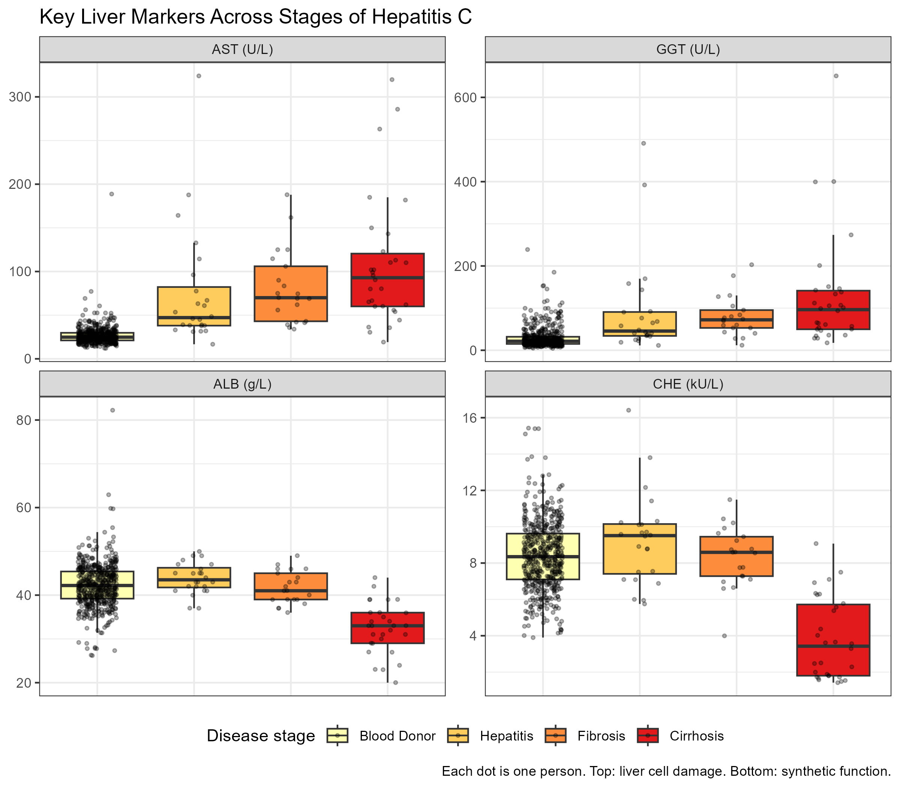

# Liver Function Markers Across Stages of Hepatitis C Infection

How do routine liver function tests change as Hepatitis C progresses from hepatitis to
fibrosis to cirrhosis? This project analyses laboratory data from 608 people
(533 healthy blood donors and 75 Hepatitis C patients) using R.

**Read the full report:** https://ayesha-nasir313.github.io/HCV-liver-markers/Report.html

Many analyses of this public dataset train machine-learning classifiers directly on the raw
values. This project instead checks the data with clinical laboratory knowledge first, and
separates differences between healthy and ill people from changes across disease stages.

## Skills shown

- **R:** data cleaning and reshaping (dplyr, tidyr, readr), figures (ggplot2)
- **Statistics:** non-parametric tests (Wilcoxon, Kruskal-Wallis, Spearman),
  Benjamini-Hochberg correction for multiple testing, adjustment for age and sex
  (linear regression)
- **Reproducible reporting:** numbered scripts, raw data never modified, R Markdown report
  that reads all results from files
- **Data-quality checks** using clinical laboratory knowledge

## Background

Pakistan has the highest number of people living with hepatitis C of any country
(WHO Global Hepatitis Report 2024). I work in a hospital laboratory in Pakistan and am moving
from wet-lab to computational work. This project combines my clinical laboratory knowledge with
data analysis in R, using a public dataset.

## Data

HCV data from the UCI Machine Learning Repository (Lichtinghagen, Klawonn & Hoffmann, 2020;
https://doi.org/10.24432/C5D612), from the Institute of Clinical Chemistry, Hannover Medical
School, Germany. It contains age, sex and 10 laboratory tests: ALB, ALP, ALT, AST, BIL, CHE,
CHOL, CREA, GGT and PROT.

## What I did

1. **Explore** (`01_explore.R`): checked the structure, groups and missing values
2. **Clean** (`02_clean.R`): split the diagnosis column, removed 7 "suspect blood donors",
   put the disease stages in order
3. **Describe** (`03_describe.R`): median (IQR) of each test per group, globulin,
   data-quality checks
4. **Visualize** (`04_visualize.R`): boxplots of all tests and the AST/ALT ratio
5. **Test** (`05_statistics.R`): Wilcoxon, Kruskal-Wallis and Spearman tests with
   Benjamini-Hochberg correction, pairwise tests, and age and sex as confounders
6. **Report** (`Report.Rmd`, `Report.html`): the full write-up

## Key findings

- **Liver cell damage markers (AST, GGT)** were higher in every patient stage than in healthy
  donors, but did not differ significantly between hepatitis, fibrosis and cirrhosis.
- **Synthetic function markers (albumin, cholinesterase)** fell sharply only in cirrhosis and
  showed the strongest trend with disease stage (Spearman rho -0.74 and -0.72). The fall in
  albumin remained after adjusting for age and sex.
- **Bilirubin** rose sharply in cirrhosis.
- **Data quality:** unusually low ALT and ALP values in patients (for example, ALT below
  10 U/L in 18 of 30 cirrhosis patients) suggest that patient and donor samples may have been
  measured differently, so donor-patient comparisons need caution.



## How to run it

1. Open `hcv_project.Rproj` in RStudio
2. Install the packages: `install.packages(c("readr", "dplyr", "tidyr", "ggplot2", "knitr", "rmarkdown"))`
3. Run the scripts in `script/` in order (`01` to `05`), then knit `Report.Rmd`

## Folders

```
HCV-liver-markers/
├── data/      raw data (never changed), clean data, results tables
├── script/    01_explore.R to 05_statistics.R
├── figures/   the 3 figures
├── Report.Rmd and Report.html
└── README.md
```

## Licence

Code: MIT License (see `LICENSE`). Data: CC BY 4.0, from the original authors (see Data).

## Author

Ayesha Nasir
