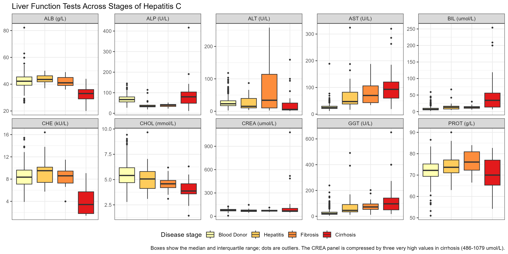
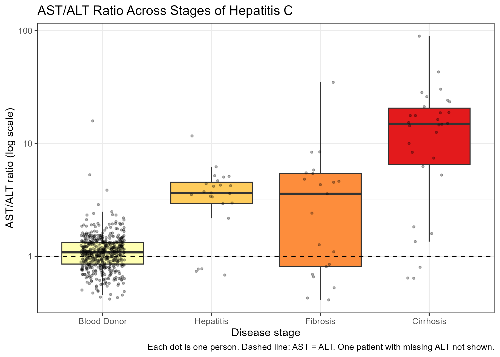

```{r setup, include = FALSE}
knitr::opts_chunk$set(echo = FALSE, message = FALSE, warning = FALSE)
library(readr)
library(dplyr)
library(tidyr)
library(knitr)
options(knitr.kable.NA = "")

hcv <- read_csv("data/hcv_clean.csv", show_col_types = FALSE)
hcv <- hcv %>%
  mutate(Diagnosis = factor(Diagnosis,
                            levels = c("Blood Donor", "Hepatitis", "Fibrosis", "Cirrhosis")))

# Units are not stated in the dataset; standard SI units are assumed
test_units <- c(ALB = "g/L", ALP = "U/L", ALT = "U/L", AST = "U/L", BIL = "umol/L",
                CHE = "kU/L", CHOL = "mmol/L", CREA = "umol/L", GGT = "U/L", PROT = "g/L")

# p-values below 0.001 are shown as "< 0.001"
fmt_p <- function(p) if_else(p < 0.001, "< 0.001", sprintf("%.3f", p))

# AST/ALT ratio trend within patients (used in the text of section 4.4)
patients <- hcv %>%
  filter(Group == "HCV patient") %>%
  mutate(AST_ALT_ratio = AST / ALT)
ratio_test <- cor.test(patients$AST_ALT_ratio, patients$Code,
                       method = "spearman", exact = FALSE)
```

## Summary

This project asked how routine liver function tests change across the stages of Hepatitis C
infection. Using a public dataset of 608 people from a German hospital laboratory (533 healthy
blood donors and 75 HCV patients with hepatitis, fibrosis or cirrhosis), I cleaned the data,
summarised each test by group, and used rank-based statistical tests with correction for
multiple testing. Markers of liver cell damage (AST, GGT) separated patients from healthy donors,
but not the disease stages from each other. Markers of synthetic function (albumin,
cholinesterase) fell sharply only in cirrhosis and followed disease stage most closely.
Unusually low ALT and ALP values in patients suggest that patient and donor samples may have
been measured differently, so comparisons between donors and patients should be interpreted
with caution.

## 1. Background

Hepatitis C virus (HCV) infection is a major public health problem. Pakistan has the
highest number of people living with hepatitis C of any country, about 8.8 million
according to the World Health Organization's 2024 Global Hepatitis Report. Chronic
infection can progress from hepatitis to fibrosis and finally to cirrhosis. Routine liver
function tests are cheap and widely available, so it is useful to know how they change as
the disease progresses.

**Question:** How do routine liver function markers change across the stages of Hepatitis C
infection, from healthy blood donors to hepatitis, fibrosis and cirrhosis?

## 2. Data

Public HCV dataset from the UCI Machine Learning Repository (Lichtinghagen, Klawonn &
Hoffmann, 2020), contributed by the Institute of Clinical Chemistry, Hannover Medical School,
Germany. It contains age, sex and 10 laboratory tests for 615 blood donors and Hepatitis C
patients: albumin (ALB), alkaline phosphatase (ALP), alanine aminotransferase (ALT),
aspartate aminotransferase (AST), bilirubin (BIL), cholinesterase (CHE), cholesterol (CHOL),
creatinine (CREA), gamma-glutamyl transferase (GGT) and total protein (PROT).
Units are not stated in the dataset; standard SI units are assumed (ALB and PROT in g/L,
enzymes in U/L, CHE in kU/L, BIL and CREA in umol/L, CHOL in mmol/L).

## 3. Methods

- **Cleaning:** the diagnosis column was split into a code and a diagnosis. Seven "suspect
  blood donors" (abnormal values without a diagnosis) were removed, leaving 608 people.
  Missing values were kept and excluded only from the calculation they affected. Extreme
  but biologically possible values (for example, creatinine 1079 umol/L in cirrhosis) were kept.
- **Description:** median and interquartile range (IQR) per group, because laboratory
  values were skewed. Globulin was calculated as total protein minus albumin.
- **Data quality:** very low ALT (< 10 U/L) and low ALP (< 40 U/L) results were counted
  in each group.
- **Graphs:** boxplots of each test across groups; the AST/ALT ratio was calculated for
  each person.
- **Statistics:** all tests are rank-based, because laboratory values were skewed.
  - Healthy donors vs all HCV patients: Wilcoxon rank-sum test.
  - All four groups: Kruskal-Wallis test.
  - Trend with disease stage in patients only (hepatitis = 1, fibrosis = 2,
    cirrhosis = 3): Spearman correlation.
  - Pairwise comparisons of all groups for all 10 tests: Wilcoxon rank-sum tests
    (60 comparisons).
  - Each set of tests was corrected for multiple testing with the Benjamini-Hochberg (BH)
    method; results were called significant if the adjusted p-value was < 0.05.
  - Age (Kruskal-Wallis) and sex (chi-square) were compared between groups, and a linear
    model of albumin was adjusted for age and sex.
- **Software:** R (readr, dplyr, tidyr, ggplot2, knitr, rmarkdown). Code: scripts 01-05.

## 4. Results

### 4.1 Study groups

```{r}
read_csv("data/group_summary.csv", show_col_types = FALSE) %>%
  kable(col.names = c("Group", "n", "Mean age", "Median age", "% male", "ALP missing"),
        caption = "Table 1. Number of people, age, percent male and missing ALP values in each group")
```

### 4.2 Laboratory values per group

```{r}
read_csv("data/median_iqr_table.csv", show_col_types = FALSE) %>%
  mutate(Unit = test_units[Test]) %>%
  relocate(Unit, .after = Test) %>%
  kable(caption = "Table 2. Median (interquartile range) of each test in each group")
```

```{r}
hcv %>%
  mutate(GLOB = PROT - ALB) %>%
  group_by(Diagnosis) %>%
  summarise(`Median globulin (g/L)` = median(GLOB, na.rm = TRUE)) %>%
  rename(Group = Diagnosis) %>%
  kable(caption = "Table 3. Globulin (total protein minus albumin) in each group")
```

### 4.3 Figures

```{r, out.width = "100%"}

```

*Figure 1. All 10 laboratory tests across disease stages.*

```{r, out.width = "80%"}
include_graphics("figures/fig2_key_markers.png")
```

*Figure 2. Markers of liver cell damage (AST, GGT) and of synthetic function (ALB, CHE).*

```{r, out.width = "70%"}

```

*Figure 3. AST/ALT ratio for each person (log scale).*

### 4.4 Statistical tests

```{r}
read_csv("data/results_healthy_vs_hcv.csv", show_col_types = FALSE) %>%
  transmute(Test,
            Unit               = test_units[Test],
            `Median, donors`   = median_healthy,
            `Median, patients` = median_hcv,
            Direction          = direction,
            `Adjusted p`       = fmt_p(p_adj)) %>%
  kable(caption = "Table 4. Healthy donors vs all HCV patients (Wilcoxon rank-sum test, BH-adjusted)")
```

```{r}
read_csv("data/results_across_stages.csv", show_col_types = FALSE) %>%
  transmute(Test, `Adjusted p` = fmt_p(p_adj), Significant = significant) %>%
  kable(caption = "Table 5. Differences among the four groups, including donors (Kruskal-Wallis test, BH-adjusted)")
```

Because Table 5 includes the donors, a significant result there can come from the
difference between healthy people and patients alone. Table 6 therefore tests how each
marker changes across the three disease stages in patients only.

```{r}
read_csv("data/results_patient_trend.csv", show_col_types = FALSE) %>%
  transmute(Test, n, rho, Direction = direction,
            `Adjusted p` = fmt_p(p_adj), Significant = significant) %>%
  kable(caption = "Table 6. Trend with disease stage in patients only (Spearman correlation, BH-adjusted)")
```

The AST/ALT ratio, calculated for each patient, also rose with disease stage
(rho = `r round(ratio_test$estimate, 2)`, p `r fmt_p(ratio_test$p.value)`).

```{r}
short_names <- c("Blood Donor" = "Donor", "Hepatitis" = "Hep",
                 "Fibrosis" = "Fib", "Cirrhosis" = "Cirr")
read_csv("data/results_pairwise.csv", show_col_types = FALSE) %>%
  mutate(Pair    = paste(short_names[Group_1], "vs", short_names[Group_2]),
         p_shown = paste0(fmt_p(p_adj), if_else(significant == "yes", " *", ""))) %>%
  select(Test, Pair, p_shown) %>%
  pivot_wider(names_from = Pair, values_from = p_shown) %>%
  kable(caption = "Table 7. Pairwise comparisons (Wilcoxon rank-sum test; BH-adjusted across all 60 comparisons; * = significant)")
```

### 4.5 Data-quality checks

```{r}
hcv %>%
  group_by(Diagnosis) %>%
  summarise(
    `ALT < 10 U/L` = paste(sum(ALT < 10, na.rm = TRUE), "of", sum(!is.na(ALT))),
    `Lowest ALT (U/L)` = min(ALT, na.rm = TRUE),
    `ALP < 40 U/L` = paste(sum(ALP < 40, na.rm = TRUE), "of", sum(!is.na(ALP))),
    `Patient ID range` = paste0(min(ID), "-", max(ID))
  ) %>%
  rename(Group = Diagnosis) %>%
  kable(caption = "Table 8. Very low ALT and low ALP results, and patient numbers, in each group")
```

### 4.6 Age and sex

```{r}
age_p <- kruskal.test(Age ~ Diagnosis, data = hcv)$p.value
sex_p <- chisq.test(table(hcv$Diagnosis, hcv$Sex))$p.value
tibble(Factor    = c("Age", "Sex"),
       Test      = c("Kruskal-Wallis", "Chi-square"),
       `p-value` = c(fmt_p(age_p), fmt_p(sex_p))) %>%
  kable(caption = "Table 9. Do age and sex differ between the four groups?")
```

```{r}
model_1 <- lm(ALB ~ Diagnosis, data = hcv)
model_2 <- lm(ALB ~ Diagnosis + Age + Sex, data = hcv)
tibble(Model = c("Stage only", "Stage + age + sex"),
       `Cirrhosis vs donors (g/L)` = round(c(coef(model_1)["DiagnosisCirrhosis"],
                                             coef(model_2)["DiagnosisCirrhosis"]), 2),
       `p-value` = fmt_p(c(summary(model_1)$coefficients["DiagnosisCirrhosis", 4],
                           summary(model_2)$coefficients["DiagnosisCirrhosis", 4]))) %>%
  kable(caption = "Table 10. Albumin difference between cirrhosis and blood donors, before and after adjusting for age and sex")
```

## 5. Discussion

### 5.1 Markers of liver cell damage (AST, GGT)

AST and GGT were higher in every patient stage than in healthy donors (Table 7). AST is an
enzyme found inside liver cells (and also in heart and skeletal muscle) and is released into the
blood when the cells are damaged. GGT rises with damage to the bile ducts and liver cells.
However, the three patient stages did not differ significantly from each other for either marker
(Table 7), and the trend with stage was weak for AST (rho = 0.27) and not significant for GGT
(Table 6). In this dataset, AST and GGT therefore show that the liver is damaged, but not how far
the disease has progressed.

### 5.2 Markers of synthetic function (ALB, CHE, CHOL) and globulin

Albumin (ALB) and cholinesterase (CHE) are made by liver cells. Both stayed close to donor
values in hepatitis and fibrosis and fell sharply only in cirrhosis: the only significant
pairwise differences were between cirrhosis and each of the other groups (Table 7). They also
showed the strongest trend with stage in patients (rho = -0.74 and -0.72; Table 6). This fits the
loss of synthetic function in cirrhosis, when much of the liver tissue has been replaced by scar
tissue. The albumin difference between cirrhosis and donors (9.8 g/L) changed very little after
adjusting for age and sex (9.5 g/L; Table 10), so it is not explained by these factors.
Cholesterol, which is also made mainly in the liver, fell more gradually and was already lower
in fibrosis than in donors (Table 7).

Total protein did not differ between donors and all patients combined (Table 4), even though
albumin fell. Globulin (total protein minus albumin) was higher in fibrosis and cirrhosis
(median 36-37 g/L) than in donors and hepatitis (30 g/L; Table 3), although this difference was
not formally tested. This supports the idea that a rise in globulins, which include the
antibodies produced in chronic infection, partly balances the fall in albumin.

### 5.3 Bilirubin

Bilirubin was higher in every patient stage than in donors and rose sharply in cirrhosis
(median 34 umol/L, compared with 13 umol/L in hepatitis and fibrosis; Table 2). Cirrhosis
differed significantly from all other groups, while hepatitis and fibrosis did not differ from
each other (Table 7). Bilirubin is taken up by liver cells, conjugated and excreted in bile, so it
builds up in the blood when liver function fails, which can cause jaundice. Like albumin and
cholinesterase, bilirubin therefore mainly reflects advanced disease.

### 5.4 Unexpected findings: ALT, the AST/ALT ratio and ALP

Some results do not match what is usually seen in chronic hepatitis C. ALT is normally raised in
chronic HCV infection, and the AST/ALT ratio is usually below 1 before cirrhosis and rises above 1
in cirrhosis (Sheth et al., 1998). In this dataset, ALT in hepatitis patients (median 15.2 U/L)
was lower than in donors (23.1 U/L), 18 of 30 cirrhosis patients had ALT below 10 U/L, and the
lowest value was 0.9 U/L (Table 8). As a result, the median AST/ALT ratio was already 3.6 in
hepatitis and 14.9 in cirrhosis (Figure 3), much higher than usually reported. ALP was also
unusually low in hepatitis patients: 16 of 21 had ALP below 40 U/L, compared with 17 of 533
donors (Table 8).

Two explanations are possible. First, ALT needs pyridoxal-5'-phosphate (vitamin B6) as a
coenzyme. Patients with cirrhosis are often deficient in vitamin B6, and assays without added
B6 then measure falsely low ALT activity, with ALT affected more than AST. This could explain
part of the low ALT in cirrhosis, but not in the younger hepatitis patients. Second, patient and
donor samples may have been collected, stored or measured differently; the patient records also
form a separate block after all donors (IDs 541-615). These data cannot tell the two explanations
apart. The AST/ALT ratio still rose with stage within patients (rho = 0.47), in the expected
direction, but its absolute values should not be compared with clinical cut-offs. The fibrosis
group was the most variable, for example in ALT (Figure 1), which may reflect different degrees
of inflammation or fibrosis within this one group.

## 6. Limitations

- **Cross-sectional data:** each person was measured once, and each stage contains different
  people. The data show differences between stages, not how one patient's values change over time.
- **Small, unequal groups:** 533 blood donors but only 21-30 patients per stage, so smaller
  differences between patient stages may be missed.
- **Possible differences between donor and patient samples:** the unusual ALT and ALP
  values in patients (Table 8), and patient numbers that follow all donor numbers, suggest
  that patient and donor samples may have been collected or measured differently.
  Comparisons among the patient stages are therefore more reliable than comparisons
  between donors and patients.
- **Missing ALP values** occurred only in patients (9 of 21 in fibrosis), so ALP results
  for the patient stages are less reliable.
- **Age and sex:** Hepatitis patients were younger than the other groups (mean 38.7 years vs
  47.1-53.5; p < 0.001), and 83% of them were male, although the difference in sex between
  groups was not significant (p = 0.12; Table 9). Only the albumin analysis was adjusted for age
  and sex; the other comparisons are unadjusted and could be partly influenced by these factors.
- **One hospital in Germany:** patients, HCV genotypes and laboratory methods may differ in
  Pakistan, where genotype 3 is most common.
- **Units and laboratory methods** are not described in the dataset.

## 7. Conclusion

In this dataset, routine liver tests changed in two different ways in Hepatitis C. Markers of
liver cell damage (AST, GGT) were raised in all patients but did not separate the disease stages,
while markers of synthetic function (albumin, cholinesterase) and bilirubin changed mainly in
cirrhosis and followed disease stage most closely. The unusual ALT and ALP values show that
checking data quality with laboratory knowledge is an essential part of analysing clinical data.

## References

1. Lichtinghagen R, Klawonn F, Hoffmann G. HCV data [Dataset]. UCI Machine Learning
   Repository; 2020. https://doi.org/10.24432/C5D612
2. Hoffmann GF, Bietenbeck A, Lichtinghagen R, Klawonn F. Using machine learning techniques
   to generate laboratory diagnostic pathways: a case study. Journal of Laboratory and
   Precision Medicine. 2018.
3. World Health Organization. Global hepatitis report 2024: action for access in low- and
   middle-income countries. Geneva: WHO; 2024.
4. Sheth SG, Flamm SL, Gordon FD, Chopra S. AST/ALT ratio predicts cirrhosis in patients
   with chronic hepatitis C virus infection. American Journal of Gastroenterology.
   1998;93(1):44-48.

## Software versions

```{r}
sessionInfo()
```
